🌐 [English](README.md) · **Español** · [Italiano](README.it.md) · [Português](README.pt.md) · [Français](README.fr.md) · [Deutsch](README.de.md) · [Ελληνικά](README.el.md) · [Български](README.bg.md) · [Українська](README.uk.md)

# 🏍️ SmartZT, app no oficial para motos Zontes

Una app no oficial para motos Zontes, creada para sustituir a la del
fabricante por algo más rápido y fiable. Se comunica con la cámara (DVR) de la
moto por Wi-Fi y con su módulo keyless PKE por Bluetooth Low Energy. Funciona
en Android y, desde la 2.1, en iPhone y iPad con una primera **versión de iOS
en pruebas** (ver [iOS (en pruebas)](#ios-en-pruebas)).

| Moto | Cámara | Consumo | Pantalla | Ajustes | Acerca de |
|:-:|:-:|:-:|:-:|:-:|:-:|
| 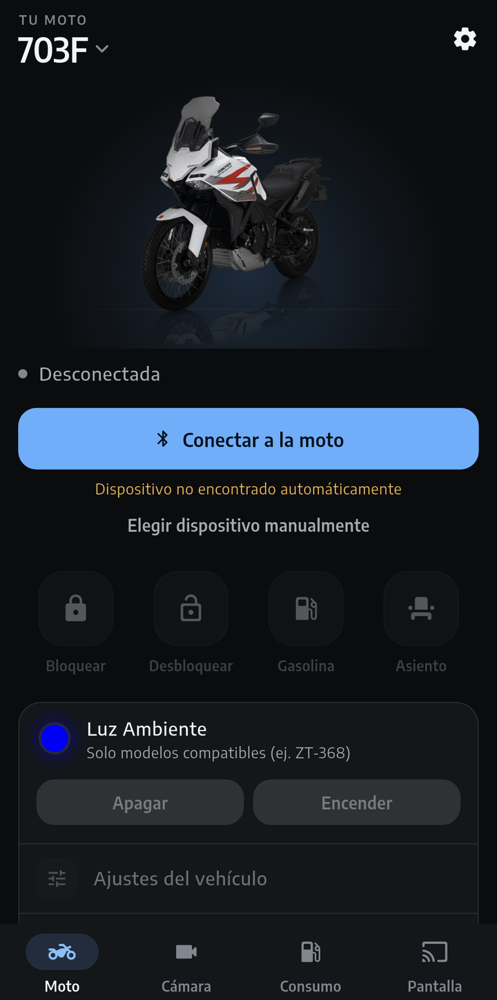 | 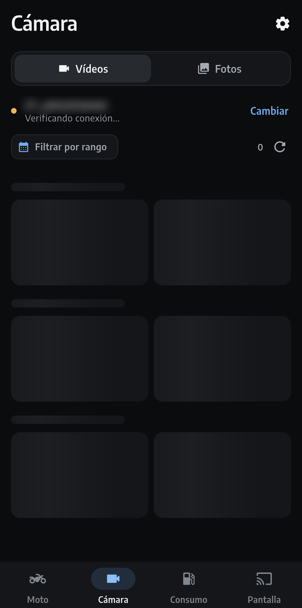 | 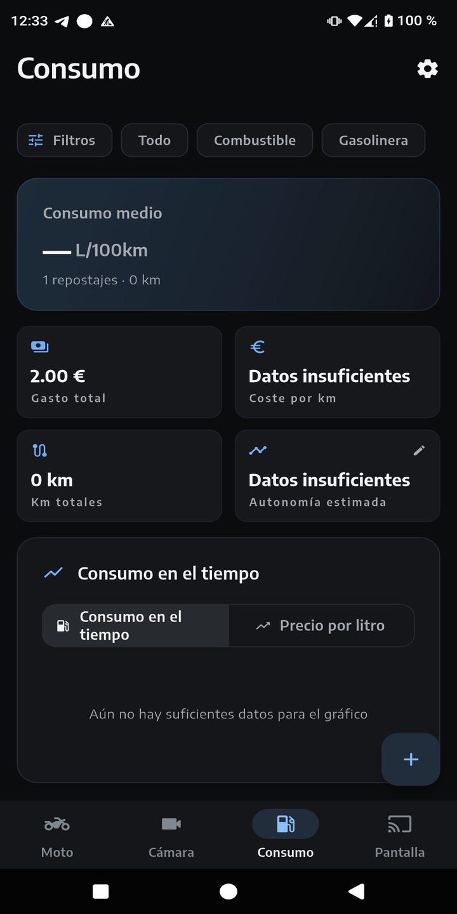 | 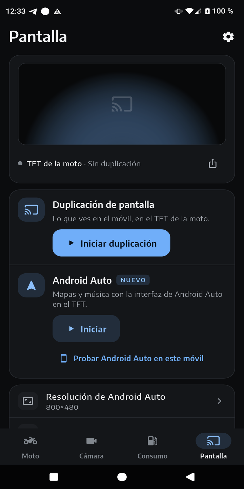 | 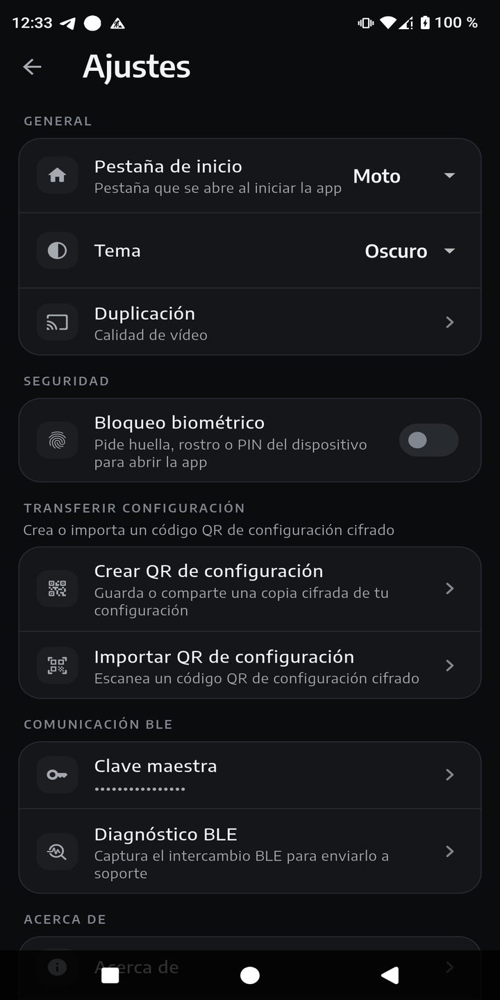 | 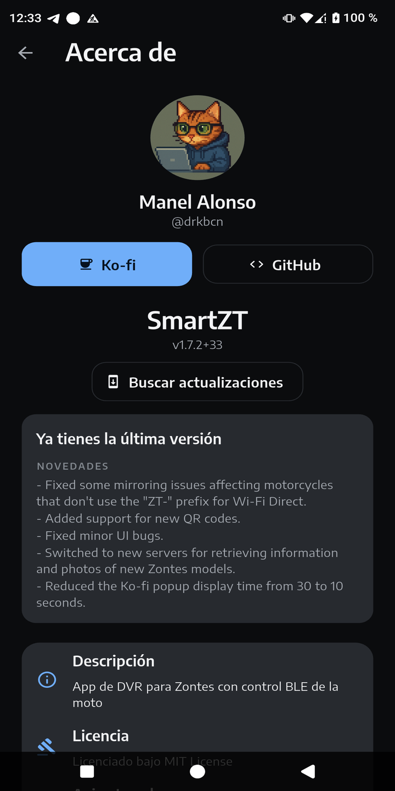 |
| 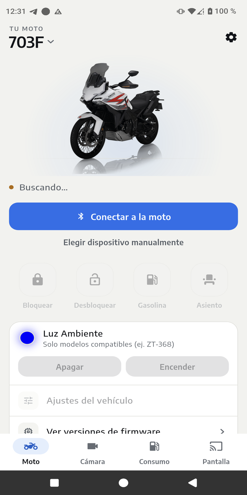 | 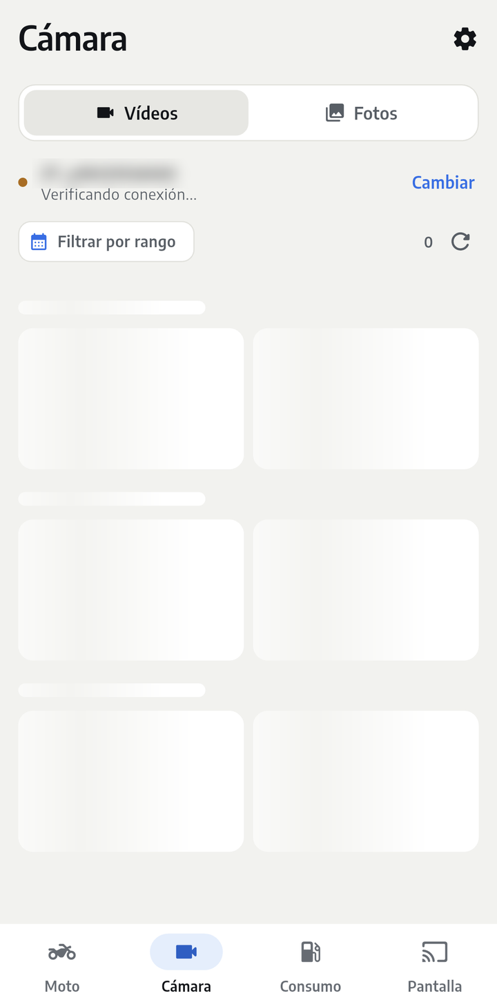 | 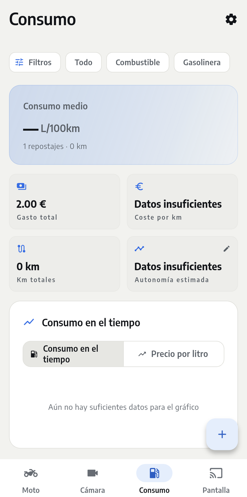 | 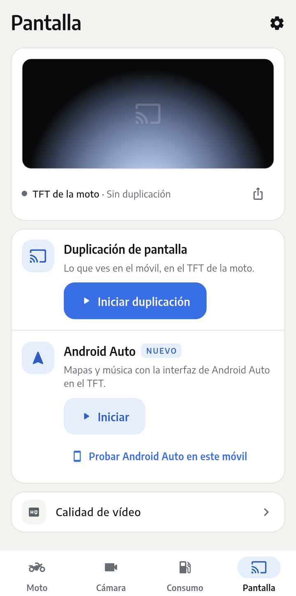 | 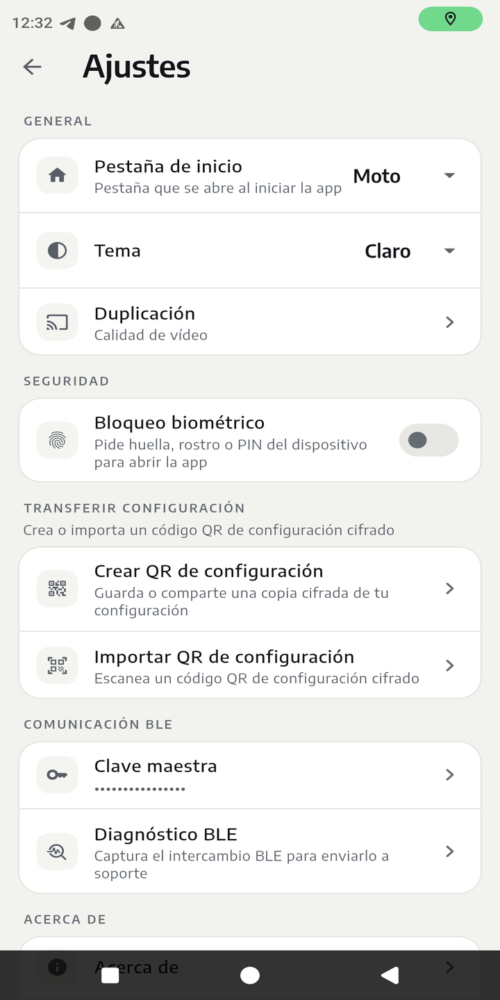 | 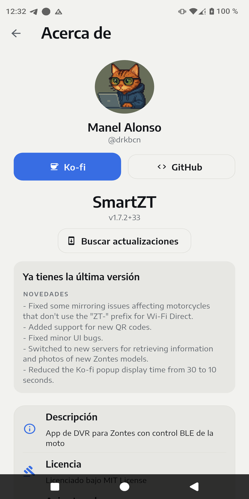 |

El tema claro, oscuro o del sistema se elige en **Ajustes › Tema**.

## Qué hace

- **Moto**: primero tu moto y su estado de conexión, con un único botón
  **Conectar a la moto**. Los controles de bloquear, desbloquear, tapón de
  combustible y asiento muestran el progreso mientras se envía la orden, y la
  luz ambiental se controla a través del módulo PKE, con el mismo esquema de
  desafío-respuesta AES que la app original.
- **Cámara**: lista y descarga los vídeos y fotos de las cámaras delantera y
  trasera del DVR, y los reproduce en la app.
- **Consumo**: un registro de repostajes con estadísticas de consumo y
  gráficas a lo largo del tiempo.
- **Pantalla**: el estado del cuadro (TFT) y dos formas de usarlo:
  - **Duplicación de pantalla**: envía la pantalla del móvil al cuadro de la
    moto por Wi-Fi Direct, con frecuencia de imagen y bitrate ajustables.
  - **Android Auto** *(experimental)*: muestra Android Auto en el cuadro, para
    apps de mapas y música como Waze o Spotify. Más detalles abajo.
- **Ajustes del vehículo**: lee y modifica parámetros guardados en la MCU de
  la moto (método de llave, tiempo de autobloqueo, alarma ESS, alarma de freno
  de mano, etc.).
- **Garaje**: gestiona más de una moto y cambia entre ellas.
- **Configuración por QR**: el emparejamiento y las credenciales Wi-Fi se
  configuran escaneando un código QR, igual que en la configuración de la moto
  o del concesionario.
- **Exportar/importar configuración**: copia de seguridad y restauración de la
  configuración de la app mediante un código QR cifrado.
- **Actualizaciones**: la app consulta esta página en busca de versiones
  nuevas (como mucho una vez al día) y te deja descargar, posponer u omitir una
  versión. **Ajustes › Acerca de** también muestra las notas de cada versión.
  Las versiones de Android no caducan nunca.

## Android Auto (experimental)

El móvil hace de unidad principal del coche: la imagen de Android Auto se
vuelve a codificar para el cuadro y los toques en el cuadro se le envían de
vuelta. El sonido de las indicaciones de navegación y la música sigue saliendo
por el móvil (por ejemplo, hacia el intercomunicador Bluetooth del casco).

- Android Auto tiene que estar instalado, y su *head unit server* de
  desarrollador hay que iniciarlo a mano: abre los ajustes de Android Auto,
  toca **Versión** unas diez veces y luego usa el menú ⋮ › **Start head unit
  server**. La app tiene un acceso directo a esos ajustes. Android no permite
  que otra app lo inicie por ti.
- La pantalla de Android Auto también se abre en el móvil, donde puedes
  tocarla para abrir apps y menús. Un botón ✕ te devuelve a SmartZT sin
  detener la proyección.
- **Probar Android Auto en este móvil** lo ejecuta sin ninguna moto
  conectada.
- El tamaño de imagen (800×480, 1280×720 o 1920×1080) se elige en la pestaña
  Pantalla. Los tamaños más grandes gastan más CPU y batería.
- Los botones del manillar no están soportados: estas motos no los envían.

No se ha probado en todos los móviles ni en todas las versiones de Android
Auto, así que puede haber fallos.

## iOS (en pruebas)

SmartZT 2.1 es la primera versión para iPhone y iPad. Está **en pruebas**:
puede haber fallos, y te agradezco que avises de lo que no funcione.

- **La duplicación de pantalla en iOS está en una fase muy inicial.** Puede
  que no arranque, o que no muestre imagen, en algunos móviles y cuadros. Si
  falla, comparte el log de duplicación (botón de compartir en la tarjeta del
  cuadro, en la pestaña Pantalla) y adjúntalo a una
  [incidencia](https://github.com/drkbcn/SmartZT/issues).
- **Funciona en iOS:** Moto (bloquear, desbloquear, asiento, tapón de
  combustible, luz ambiental, voltaje de la batería), Cámara (vídeos y fotos
  del DVR), Consumo, Garaje, Ajustes del vehículo, configuración por QR y
  exportar/importar configuración.
- **No disponible en iOS:** Android Auto, el HUD de navegación, la capa de
  protección de pantalla y los widgets de la pantalla de inicio. En iOS no
  existe Wi-Fi Direct, así que te unes a mano al Wi-Fi del DVR desde la app
  Ajustes de iOS; SmartZT te muestra su nombre y su contraseña.
- **Requisitos:** iOS 15 o posterior (la duplicación de pantalla necesita
  iOS 16 o posterior), un Apple ID (sirve uno gratuito) y un ordenador con
  Windows, macOS o Linux para instalar la app.

### Instalación en iPhone o iPad (sideloading)

SmartZT no está en la App Store. El `.ipa` de la página de
[Releases](https://github.com/drkbcn/SmartZT/releases) se instala con tu
propio Apple ID usando **[Impactor](https://github.com/claration/Impactor)**,
una herramienta de sideloading gratuita y de código abierto:

1. Descarga `SmartZT-<versión>.ipa` de la última versión.
2. Instala Impactor desde su
   [página de releases](https://github.com/claration/Impactor/releases):
   - **Windows:** instala antes [iTunes](https://support.apple.com/en-us/106372);
     Impactor usa sus drivers para comunicarse con el iPhone.
   - **macOS:** `brew install --cask impactor`, o descárgalo.
   - **Linux:**
     [Flathub](https://flathub.org/apps/dev.khcrysalis.PlumeImpactor).
     Necesita `usbmuxd`, que ya incluyen la mayoría de distribuciones.
3. Conecta el iPhone por USB, desbloquéalo y acepta **Confiar** cuando
   pregunte por el ordenador.
4. Abre Impactor, inicia sesión con tu Apple ID, elige el `.ipa` de SmartZT e
   instálalo.
5. En iOS 16 o posterior, activa **Ajustes › Privacidad y seguridad › Modo de
   desarrollador** (*Settings › Privacy & Security › Developer Mode*) y
   reinicia el móvil cuando lo pida.
6. Si iOS dice que el desarrollador no es de confianza, abre **Ajustes ›
   General › VPN y gestión de dispositivos** (*Settings › General › VPN &
   Device Management*), toca tu Apple ID y pulsa **Confiar**.

**Si Impactor muestra** `An Application Group with Identifier
'group.com.vitapps.smartzt.…' is not available`, vuelve a instalarla: puede
pasar en la primera instalación, y en el segundo intento el grupo ya está
creado.

**Para actualizar**, descarga el `.ipa` nuevo e instálalo encima del actual
de la misma forma.

### Cuánto dura la instalación

| Opción | Sigue abriéndose | Coste | Probado con SmartZT |
|---|---|---|---|
| Apple ID gratuito (Impactor) | 7 días, luego hay que renovarla | Gratis | Sí |
| SideStore (Apple ID gratuito) | 7 días, se renueva en el iPhone | Gratis | No |
| Cuenta de desarrollador de Apple de pago | 1 año | 99 USD al año | No |
| TrollStore | No caduca | Gratis | No (solo iOS antiguos) |

**Apple ID gratuito (7 días).** Apple hace que la app deje de abrirse a los 7
días de firmarla. Renuévala antes o vuelve a instalarla; tu garaje, tus ajustes
y tu registro de repostajes se conservan.

- Impactor puede renovarla por ti: activa su opción de renovación al
  instalarla. En Windows y macOS la renueva en segundo plano mientras el
  ordenador esté encendido y el iPhone en la misma Wi-Fi; en Linux, solo
  mientras el iPhone esté conectado por cable.
- Puede haber como máximo 3 apps instaladas por sideloading a la vez, y solo se
  pueden registrar 10 identificadores de app por semana. SmartZT usa 2: la app y
  su extensión de emisión de pantalla.
- AltStore y Sideloadly funcionan igual, pero aún no se han probado.

**SideStore (7 días, sin ordenador).** [SideStore](https://sidestore.io) vive en
el iPhone y vuelve a firmar tus apps allí mismo, mediante una VPN local en el
propio móvil (LocalDevVPN). Necesitas un ordenador una vez para instalarlo
(Impactor puede hacerlo); a partir de ahí renueva SmartZT cada semana por sí
solo a través de la Wi-Fi. Sigue usando un Apple ID gratuito, así que los
límites de 7 días y 3 apps se mantienen, y SideStore cuenta como una de las 3.

**Cuenta de desarrollador de Apple de pago (1 año).** Con una suscripción al
[Apple Developer Program](https://developer.apple.com/programs/) (99 USD al
año), inicia sesión en Impactor con esa cuenta: la app dura un año (menos si la
suscripción termina antes) y desaparecen los límites de 3 apps y 10
identificadores. Los pasos son los mismos.

**TrollStore (permanente, solo iOS antiguos).**
[TrollStore](https://github.com/opa334/TrollStore) aprovecha un fallo de iOS
para instalar apps que no caducan nunca, sin Apple ID. Apple corrigió el fallo,
así que solo funciona en iOS 14.0 a 16.6.1, 16.7 RC y 17.0, y nunca en 16.7.x ni
en 17.0.1 o posterior. La duplicación de pantalla necesita iOS 16, así que para
la app completa eso significa iOS 16.0 a 16.6.1, 16.7 RC o 17.0. Instala
TrollStore con la guía de
[ios.cfw.guide](https://ios.cfw.guide/installing-trollstore) y abre con él el
`.ipa` de SmartZT. Sin probar: la duplicación de pantalla necesita que la app y
su extensión de emisión compartan datos, y eso puede no funcionar con
TrollStore.

Evita los servicios de pago de "certificados de firma": Apple los revoca a
menudo y la app deja de abrirse sin avisar.

### Duplicación de pantalla en iOS

1. Únete al Wi-Fi de la moto desde la app Ajustes de iOS (SmartZT te muestra
   su nombre y su contraseña) y vuelve a SmartZT.
2. En la pestaña **Pantalla**, inicia la duplicación.
3. En la hoja de emisión de pantalla de iOS, elige **SmartZT** y toca el botón
   para iniciar la emisión.
4. Mantén el móvil desbloqueado. Mientras está bloqueado, el cuadro muestra
   una imagen de "teléfono bloqueado". **Seguir activo con el móvil
   bloqueado** reproduce un audio inaudible para que iOS mantenga viva la
   duplicación; gasta más batería.

## Antes de empezar

El control por BLE (bloquear/desbloquear, asiento, tapón de combustible, luz
ambiental) necesita una clave de cifrado de Zontes de 16 caracteres para
autenticarse con el módulo PKE. Esta clave **no se distribuye con la app**: sin
ella, el control por BLE no funciona.

## Estado

Es un cliente hecho por ingeniería inversa: las tramas BLE, el cifrado y la
API HTTP del DVR se han sacado de la app original, no de documentación
oficial. Puede haber fallos con combinaciones de moto y firmware poco
habituales.

## Instalación

Este repositorio no aloja el código fuente, solo versiones firmadas.

- **Android:** descarga el último APK de la página de
  [Releases](https://github.com/drkbcn/SmartZT/releases) e instálalo encima de
  tu versión actual; tu garaje, tus ajustes y tu registro de repostajes se
  conservan. Las versiones marcadas como *Pre-release* son betas, y la
  comprobación de actualizaciones de la app no las ofrece.
- **iPhone y iPad:** consulta
  [Instalación en iPhone o iPad](#instalación-en-iphone-o-ipad-sideloading).

## Idiomas

Inglés, español, italiano, portugués, francés, alemán, griego, búlgaro y
ucraniano. (El griego, el ucraniano y el búlgaro usan la fuente del sistema.)

## Aviso

Este proyecto no está afiliado a Zontes, ni respaldado ni soportado por ella.
Úsalo bajo tu propia responsabilidad.
